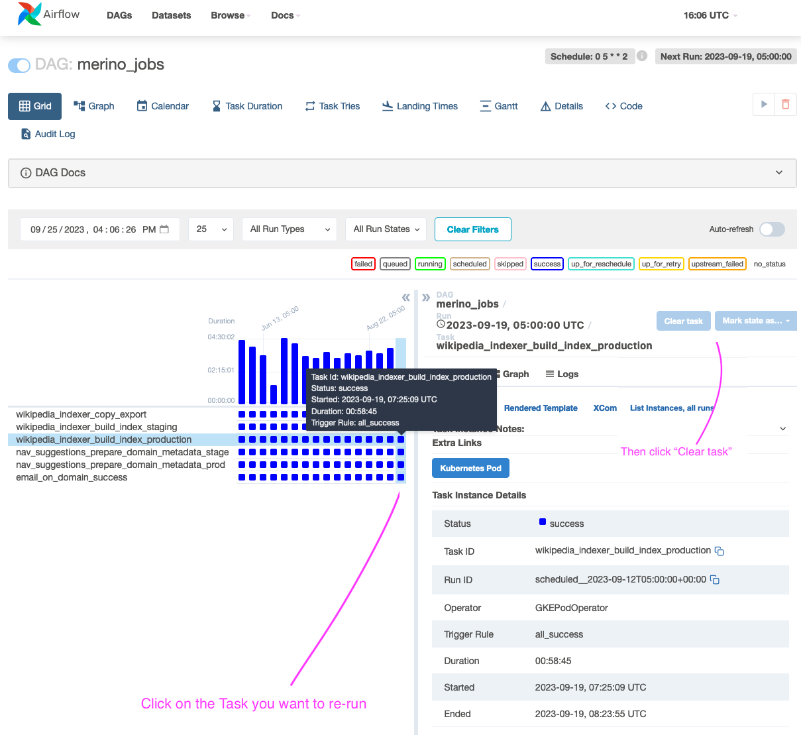
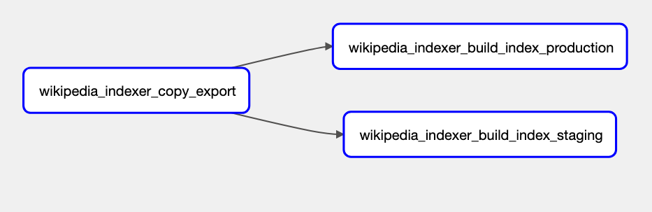
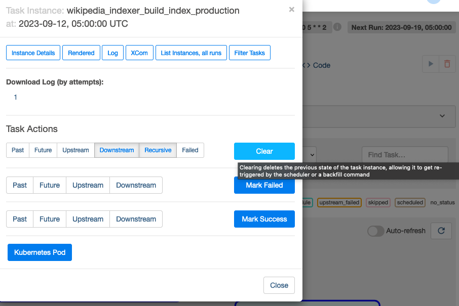

# Merino Jobs Operations

## Dynamic Wikipedia Indexer Job

Merino currently builds the Elasticsearch indexing job that runs in Airflow.
Airflow takes the `latest` image built as the base image.
The reasons to keep the job code close to the application code are:

1. Data models can be shared between the indexing job and application more easily.
   This means that data migrations will be simpler.
2. All the logic regarding Merino functionality can be found in one place.
3. Eliminates unintended differences in functionality due to dependency mismatch.

If your reason for re-running the job is needing to update the blocklist to avoid certain suggestions from being displayed,
please see the [wikipedia blocklist runbook][wiki_blocklist_runbook].

## Where the exports come from

The `copy-export` step reads Wikimedia's CirrusSearch index dumps from
<https://dumps.wikimedia.org/other/cirrus_search_index/>. That listing holds one directory per
weekly snapshot (`20260816/`), and within each snapshot one directory per index
(`index_name=enwiki_content/`). Upstream shards each index into many bzip2 files to parallelize
dump generation — English is currently around 66 shards of roughly 630 MB each.

The job traverses snapshots newest-first and copies the shards of the first complete one to GCS,
**one object per shard**, under a prefix named for the snapshot:

```
<gcs_path>/<lang>wiki-<date>-cirrussearch-content/
    <lang>wiki_content-<date>-00000.json.bz2
    ...
    _SUCCESS
```

Shards are copied three at a time. dumps.wikimedia.org states that _"Downloads are also rate limited and capped at 3 connections per-IP"_ and blocks clients that work around it. `DOWNLOAD_CONCURRENCY` in `filemanager.py` must not be raised.

### Success markers

A snapshot only counts as complete once Wikimedia writes a `_SUCCESS` marker beside its shards, which happens roughly 12 hours after the directory first appears. A snapshot without the marker is skipped in favour of the previous one, so a run logging `Currently up to date` shortly after a new snapshot appears is expected rather than a failure.

### Resuming a failed copy

A failed `copy-export` leaves whatever shards it managed to copy in place and does not write the marker. Re-running it skips shards already on GCS at their upstream size and re-fetches the rest, so a retry resumes rather than re-transferring all shards. A shard that was truncated by a failed write
has the wrong size and is re-copied.

Note that objects from the previous single-file layout
(`<lang>wiki-<date>-cirrussearch-content.json.bz2`) are ignored, not deleted. They can be removed manually once a run under the new layout has succeeded.

## Cross-cluster replication

### Prerequesites

Auto-follow patterns must be configured for wikipedia indices on follower clusters. Auto-follow should _ignore_ any indices with the "temp-" prefix, as temporary indices are used to perform operations on leader indices which don't replicate to followers (e.g. refresh, force-merge segments). Index lifecycle management rules are not cloned, so all follower clusters must be set up with appropriate ILM rules.

### Indexing Wikipedia

Creating indices with new data dumps proceeds as follows:

1. **Build under a temporary name.** Documents are indexed into `temp-<index>`, which is
   then refreshed and force merged to a single segment. Followers must be configured to ignore this index. Refreshes and force merges on the leader don't replicate to followers, so perform these operations on the temporary index before cloning
   to an index that _is_ replicated.
2. **Clone to the real name.** The build index is write-blocked and cloned to `<index>`,
   and the write block is lifted on the clone. Auto-follow picks up the clone, and
   each follower bootstraps by copying its finished, searchable segments.
3. **Wait for followers.** Before the alias is flipped, the job polls the leader for
   the CCR retention leases on `<index>`. Each follower holds one lease per primary
   shard, and the follower has caught up once its leases retain nothing at or below
   the leader's global checkpoint. The job waits at least `follower_discovery_period`
   so that auto-follow has time to find the index, then waits until every follower it
   found has caught up. It logs `Discovered follower` with `seconds_since_clone` for each
   follower, which helps when tuning the discovery period. If the leader has no
   followers, the job logs `Index has no followers` and continues.
4. **Flip the alias.** Alias changes replicate separately from the data, so the alias
   only moves once the followers hold the full index.

If followers haven't caught up within `follower_sync_timeout`, the job fails and deletes
the new index, and the alias keeps pointing at the previous one. The `temp-` build index
is always deleted, whether the run succeeds or fails.

If running on a cluster that has no followers, the job will wait out the full `follower_discovery_period` (see [configuration](#configuration) below) but
otherwise should proceed successfully.

### Configuration

The settings live under `[default.jobs.wikipedia_indexer]` in
`apps/merino/merino/configs/default.toml`. You can override them with environment
variables or with the matching `merino-jobs wikipedia-indexer index` CLI options:

| Setting                       | Default | Description                                                                                                     |
| ----------------------------- | ------- | --------------------------------------------------------------------------------------------------------------- |
| `follower_sync_timeout`       | `3600`  | Seconds to wait for followers to replicate the new index before failing the run.                                |
| `follower_sync_poll_interval` | `15`    | Seconds between checks on follower progress.                                                                    |
| `follower_discovery_period`   | `120`   | Minimum seconds to wait for auto-follow to pick up the new index. Followers that appear later aren't waited on. |

Environment variables follow the pattern
`MERINO_JOBS__WIKIPEDIA_INDEXER__FOLLOWER_SYNC_TIMEOUT`, and the CLI options follow the
pattern `--follower-sync-timeout`.

### Testing locally

`make docker-compose-up-ccr` starts a local leader (`es01`, port 9200) and follower (`es02`,
port 9201) with a matching auto-follow pattern. See
[Elasticsearch in Dependencies](../../dev/dependencies.md#elasticsearch), which also
covers the 30-day trial license that CCR requires locally.

## Running the job in Airflow

Normally, the job is set as a cron to run at set intervals as a [DAG in Airflow][airflow_docs].
There may be instances you need to manually re-run the job from the Airflow dashboard.

### Grid View Tab (Airflow UI)

1. Visit the [Airflow dashboard for `merino_jobs`][merino_jobs-grid].
2. In the Grid View Tab, select the task you want to re-run.
3. Click on 'Clear Task' and the executor will re-run the job.
   

### Graph View Tab (Airflow UI) - Alternative

1. Visit the [Airflow dashboard for `merino_jobs`][merino_jobs-graph].
2. From the Graph View Tab, Click on the `wikipedia_indexer_build_index_production` task.
   
3. Click on 'Clear' and the job will re-run.
   

Note: You can also re-run the stage job, but the changes won't reflect in production. Stage should be re-run in the event of an error before running in prod to verify the correction of an error.

See Airflow's [documentation on re-running DAGs][airflow_rerun_dag] for more information and implementation details.
See Airflow's [documentation on re-running DAGs][airflow_rerun_dag] for more information and implementation details.

To see the code for the `merino_jobs` DAG, visit the [telemetry-airflow repo][merino_jobs_repo]. The source for the job is also in the ['code' tab][merino_jobs_code] in the airflow console.

To see the Wikipedia Indexer code that is run when the job is invoked, visit [Merino `jobs/wikipedia_indexer`][wini_job_dir].

[wiki_blocklist_runbook]: https://github.com/mozilla-services/merino-py/blob/main/docs/operations/blocklist-wikipedia.md
[wini_job_dir]: https://github.com/mozilla-services/merino-py/tree/main/apps/merino/merino/jobs/wikipedia_indexer
[airflow_docs]: https://airflow.apache.org/docs/apache-airflow/stable/public-airflow-interface.html#dags
[airflow_rerun_dag]: https://airflow.apache.org/docs/apache-airflow/stable/core-concepts/dag-run.html#re-run-dag
[merino_jobs_repo]: https://github.com/mozilla/telemetry-airflow/blob/main/dags/merino_jobs.py
[merino_jobs_code]: https://workflow.telemetry.mozilla.org/dags/merino_jobs/code?root=
[merino_jobs-grid]: https://workflow.telemetry.mozilla.org/dags/merino_jobs/grid
[merino_jobs-graph]: https://workflow.telemetry.mozilla.org/dags/merino_jobs/graph?root=
