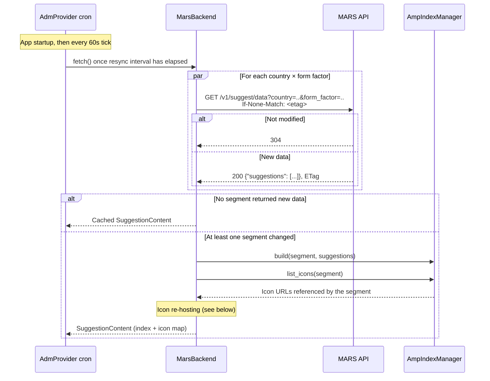
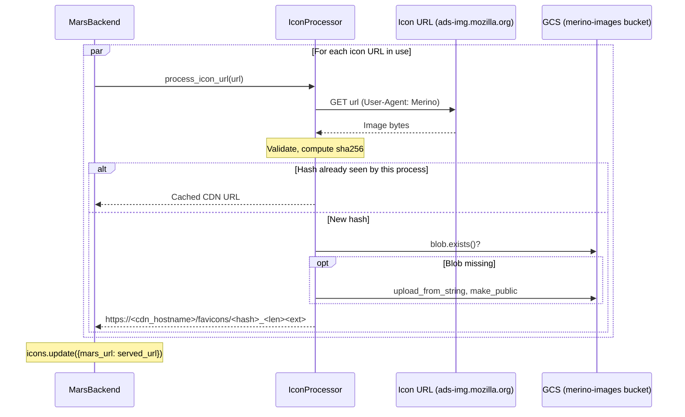

# ADM (Sponsored Suggestions) Provider

Serves sponsored suggestions (AMP) from the Mozilla Ads Routing Service (MARS). Each web pod periodically downloads suggestion data from MARS, builds an in-memory keyword index per segment, and re-hosts the advertiser icons referenced by that data on Merino's image CDN.

## Data Sync from MARS

The provider fetches MARS data once on startup and then runs a `resync_rs_data` cron job in the background (`apps/merino/merino/providers/suggest/adm/provider.py`). The job ticks every `cron_interval_sec` (default=60s) and fetches when `resync_interval_sec` (default=3600s) has elapsed since the last successful fetch.

A fetch requests one MARS segment per configured country × form factor (by default `US` × `desktop`). Each segment request sends the last ETag seen for that segment in `If-None-Match`. Segments that return `304 Not Modified` or an empty suggestion list are skipped. If no segment returns new data, the fetch returns the cached content and skips icon processing entirely.

## Icon Re-hosting

Each MARS suggestion has an `icon` field containing a full image URL. These URLs point to `ads-img.mozilla.org`, a Mozilla-operated image service behind a CDN. To maintain consistency and create operational isolation, Merino re-hosts the images on its own CDN.

After the indexes are built, `MarsBackend.fetch()` collects every icon URL referenced by the rebuilt segments and passes each one to `IconProcessor.process_icon_url()` (`apps/merino/merino/utils/icon_processor.py`) concurrently in an `asyncio.TaskGroup`. The result is an in-memory map of MARS icon URL → served icon URL, stored on `SuggestionContent.icons`.

### Processing Steps

`process_icon_url(url)` does the following:

1. If `url` already starts with `https://<cdn_hostname>`, return it unchanged.
2. Download the image with the shared HTTP client (`icon.http_timeout`, 5s).
3. Validate it: the `Content-Type` must contain `image/` and the size must be between 10 bytes and `icon.max_size` (16 MiB).
4. Compute the SHA-256 of the image bytes. If this process has already handled the same hash, return the cached CDN URL.
5. Upload to `<icon.favicons_root>/<sha256>_<length><ext>` in the `image_gcs` bucket, with `Cache-Control: icon.cache_control` (12 hours). `GcsUploader` skips the upload if the object already exists. The file extension is derived from the `Content-Type`, or detected from the image content if the type is unknown.
6. Cache and return the public CDN URL.

The image bytes are used only to validate, hash and upload the icon. They are not kept after processing.

### Fallback Behavior

If processing fails, the original MARS icon URL is stored in the map, so Firefox loads the icon directly from `ads-img.mozilla.org`.

| Condition                                            | Served icon URL                                       |
| ---------------------------------------------------- | ----------------------------------------------------- |
| Download failed (timeout, non-2xx, connection error) | Original MARS URL                                     |
| Image failed validation                              | Original MARS URL                                     |
| Any other exception during processing                | Original MARS URL                                     |
| GCS upload raised an error                           | CDN URL (see [Known Limitations](#known-limitations)) |
| Icon URL missing from the map at request time        | `"-1"` (`MISSING_ICON_ID`)                            |

### Request Time

No icon processing happens on the request path. When building a suggestion, the provider looks up the suggestion's MARS icon URL in the in-memory map: `icons.get(res.icon, MISSING_ICON_ID)`.

## Operational Characteristics

- **Per pod:** every web pod runs the sync and icon re-hosting independently, in every region where Merino is deployed. Pods don't share state with each other.
- **Re-downloads:** every fetch that returns new data downloads every icon in use, because the only cache is keyed by content hash, which needs the bytes. Uploads are not repeated: the content-hash cache and the GCS `exists()` check skip them.
- **Startup:** a new pod has no ETags and an empty content-hash cache. Its first fetch downloads every segment and every icon, and makes one GCS `exists()` call per icon.
- **Content-addressed objects:** concurrent uploads of the same icon by different pods write identical objects, so duplicate writes are harmless.

## Known Limitations

- **Synchronous GCS calls:** `exists()`, `upload_from_string()` and `make_public()` use the synchronous `google-cloud-storage` client directly on the event loop. Other GCS writers in Merino wrap these calls in `asyncio.to_thread` (see [ADR 0005](../adr/0005-asynchronous-gcs-client.md)).
- **Swallowed upload errors:** `GcsUploader.upload_content()` logs upload errors and returns the blob anyway, so `IconProcessor` returns and caches a CDN URL for an object that may not exist. The content-hash cache keeps that URL for the life of the process.
- **Icon map is never pruned:** `SuggestionContent.icons` is only ever updated, so URLs no longer referenced by MARS stay in memory.

## Configuration

| Setting                             | Environment variable                         | Default                               | Description                             |
| ----------------------------------- | -------------------------------------------- | ------------------------------------- | --------------------------------------- |
| `providers.adm.backend`             | `MERINO_PROVIDERS__ADM__BACKEND`             | `mars`                                | Backend: `mars` or `test`               |
| `providers.adm.cron_interval_sec`   | `MERINO_PROVIDERS__ADM__CRON_INTERVAL_SEC`   | `60`                                  | Cron tick interval                      |
| `providers.adm.resync_interval_sec` | `MERINO_PROVIDERS__ADM__RESYNC_INTERVAL_SEC` | `3600`                                | Minimum time between MARS fetches       |
| `mars.base_url`                     | `MERINO_MARS__BASE_URL`                      | `https://ads.mozilla.org/v1/suggest/` | MARS API base URL                       |
| `mars.countries`                    | `MERINO_MARS__COUNTRIES`                     | `["US"]`                              | Countries to fetch                      |
| `mars.form_factors`                 | `MERINO_MARS__FORM_FACTORS`                  | `["desktop"]`                         | Form factors to fetch                   |
| `image_gcs.gcs_project`             | `MERINO_IMAGE_GCS__GCS_PROJECT`              | (per environment)                     | GCS project for re-hosted icons         |
| `image_gcs.gcs_bucket`              | `MERINO_IMAGE_GCS__GCS_BUCKET`               | (per environment)                     | GCS bucket for re-hosted icons          |
| `image_gcs.cdn_hostname`            | `MERINO_IMAGE_GCS__CDN_HOSTNAME`             | (per environment)                     | CDN hostname used in returned icon URLs |
| `icon.favicons_root`                | `MERINO_ICON__FAVICONS_ROOT`                 | `favicons`                            | Object prefix within the bucket         |
| `icon.max_size`                     | `MERINO_ICON__MAX_SIZE`                      | `16777216`                            | Maximum icon size in bytes              |
| `icon.http_timeout`                 | `MERINO_ICON__HTTP_TIMEOUT`                  | `5`                                   | Icon download timeout in seconds        |
| `icon.cache_control`                | `MERINO_ICON__CACHE_CONTROL`                 | `public, max-age=43200`               | `Cache-Control` set on uploaded icons   |

## Metrics

See [Data collection](../data.md#adm-sponsored-suggestions) and `apps/merino/metrics.yaml` for full descriptions.

- MARS sync: `mars.fetch`, `mars.fetch.response_size_bytes`, `mars.data.staleness_seconds`
- Index: `amp.index.*`
- Icon re-hosting: `icon_processor.*`

`icon_processor.requests` counts every call to `process_icon_url`, including CDN URLs that are returned unchanged and content-hash cache hits. `icon_processor.processed` counts only first-time processing of a hash in a pod. The fraction of icons served from the original MARS URL is approximately `(download_failures + invalid_images + errors) / requests`.
